<!-- Theme: bg #0a0714 · accent #a855f7 · accent-2 #c084fc · pink #e879f9 · amber #eab308 · violet #6d28d9 -->

<div align="center">

" width="100%"/>


# Soham **Roy**

<a href="https://sohamroy.com">
  
</a>

**Engineering high-throughput systems that never sleep.**
7+ years turning complex distributed challenges into elegant solutions —
payment platforms processing **800K+ daily transactions**, cloud-native microservices at enterprise scale.

<br/>

<a href="https://sohamroy.com"></a>
<a href="mailto:noelleroy720@gmail.com"></a>
<a href="https://linkedin.com/in/dev-soham"></a>
<a href="https://sohamroy.com/games"></a>

<br/><br/>


</div>

<br/>

<div align="center">

| **7+** | **800K+** | **6** | **99.9%** |
|:---:|:---:|:---:|:---:|
| `YEARS EXPERIENCE` | `DAILY TRANSACTIONS` | `COMPANIES` | `UPTIME DELIVERED` |

</div>

```bash
> initializing sohamroy.com
> loading backend expertise...
> connecting distributed systems...
> 800K+ transactions / day [ok]
> ready.
```

<p align="center">
  <a href="https://sohamroy.com"></a>
  <a href="https://sohamroy.com"></a>
</p>

---

## `// TECHNICAL ARSENAL`

### Skills that ship

> Production-proven across the full backend stack — now with agentic AI. Four animated 3D views of the same toolkit: **floating tiles**, an **orbiting skill map**, an **extruded donut**, and a **cube heatmap**.

<p align="center">
  <a href="https://sohamroy.com/arsenal"></a>
</p>

<br/>

### 🧊 View 1 · The stack at a glance

<a href="https://sohamroy.com/arsenal#stack"></a>

<details>
<summary><b>Plain badge version</b> (brand logos &amp; colors)</summary>
<br/>

<table>
<tr>
<td width="50%" valign="top">

**⚙️ Backend & APIs**<br/>


</td>
<td width="50%" valign="top">

**🤖 AI / LLM**<br/>


**🎨 Frontend**<br/>


</td>
</tr>
<tr>
<td width="50%" valign="top">

**☁️ Cloud & DevOps**<br/>


</td>
<td width="50%" valign="top">

**🗄️ Data**<br/>


**🔐 Security & Testing**<br/>


</td>
</tr>
</table>

</details>

<br/>

### 🪐 View 2 · The skill map

<a href="https://sohamroy.com/arsenal#map"></a>

<br/>

### 🍩 View 3 · The breakdown

*Number of technologies and practices listed per area of the stack.*

<a href="https://sohamroy.com/arsenal#breakdown"></a>

<br/>

### 🔥 View 4 · Where I've shipped it

*Every cube is a technology named in that role on my CV — read across to see how the stack grew from role to role.*

<a href="https://sohamroy.com/arsenal#shipped"></a>

<br/>

### Domain expertise

<p align="center">
  
  
  
  <br/>
  
  
  
</p>

---

## `// CAREER JOURNEY`

### 7 Years of impact

> From analyst to technical leader — each role a new dimension of scale, complexity, and ownership.

**Senior backend engineer with 7+ years** building production Node.js / TypeScript services (NestJS, Express) on AWS Serverless, with React for operations dashboards. Currently leads an **agentic AI accounts-payable platform** in production — LLM agents match invoices, run budget and fraud-risk checks and execute authorised payments inside strict spend, approval and audit controls. Mentor and architecture lead who brought **Claude Code** into daily engineering practice.

#### ✨ Key achievements

| 🤖 Agentic AI in production | 🏗️ Platform leadership | ✅ Quality & delivery | 📈 Scale & trust |
|:--|:--|:--|:--|
| Shipped an LLM-agent payments workflow, from invoice matching to authorised payment, with spend limits, human approval and audit logs. | Led backend architecture of a shared platform onboarded by **4 product teams** within one quarter; mentored **6 engineers**. | Test coverage **12% → 74%**, deployment lead time **halved**, failed deployments **down 80%**. | **500K+** monthly users, **100K+** students, a **10K+** concurrent-user load test, **97%** field-level document-extraction accuracy. |

<br/>

### ◆ Senior Software Engineer (Lead Developer) — **Synechron Technologies**
`2025 – Present` · 📍 Bengaluru, India

- ▸ **Agentic AI Financial Platform:** Led delivery of an agentic AI accounts-payable system (Node.js / NestJS, LLM APIs, PostgreSQL) that automates invoice matching, budget and fraud-risk checks, exception routing and authorised payments end to end — reducing manual finance work and speeding supplier settlement.
- ▸ **AI Safety & Spend Guardrails:** Made AI-executed payments safe and auditable by building the agents' tools and APIs (TypeScript) with enforced spend limits, human approval for high-value payments, audit logs and retries.
- ▸ **AI-First SDLC Adoption:** Moved the team to an agentic-first workflow — introduced **Claude Code** for features, tests, large migrations, code review and debugging, backed by a shared `CLAUDE.md`, custom commands and review rules; now in daily use.
- ▸ **Backend Architecture & Leadership:** Led the backend architecture of a shared platform (Node.js / NestJS, Java / Spring Boot, PostgreSQL) adopted by **4 product teams within a quarter**; mentored **6 engineers** on quality standards.
- ▸ **Pluggable Architecture:** Enabled provider switches with **zero consumer code changes** by designing a versioned, pluggable REST abstraction layer for third-party integrations (NestJS / TypeScript).
- ▸ **Data Security:** Achieved **97% field-level accuracy** in payment-document extraction and secured data transfer with a PII-masking REST API.


<br/>

### ◆ Senior Software Engineer (Contract) — **Astria Digital**
`2024 – 2025` · 📍 Bengaluru, India

- ▸ **CI/CD Optimization:** Halved deployment lead time and cut failed deployments by **80%** by automating CI/CD pipelines.
- ▸ **Test Automation:** Raised automated test coverage from **12% to 74%** across all REST APIs with a Jest framework and review standards.
- ▸ **Production Reliability:** Improved reliability with decoupled, idempotent, retry-safe event-driven microservices (Node.js, Spring Boot) plus monitoring and alerting.
- ▸ **Operations Dashboard:** Gave the operations team daily visibility of system health by building an admin and operations dashboard in React and TypeScript on the platform's REST APIs.


<br/>

### ◆ Senior Software Engineer (Contract) — **Light Zip Technologies**
`2023 – 2024` · 📍 Bengaluru, India

- ▸ **High-Concurrency Backend:** Built the backend of Light Zip Technologies, a transporter app **load-tested with 10K+ concurrent users** — NestJS microservices on Kubernetes (GraphQL, TypeORM, MySQL, RabbitMQ) with Razorpay payments and Tata Tele telephony.
- ▸ **Internal CRM Enhancement:** Strengthened the internal CRM admin portal for concurrent use with Node.js, Express.js and TypeScript, and integrated Google Maps APIs.
- ▸ **Cloud Infrastructure:** Delivered a secure, scalable AWS backend (Lambda, SNS, SQS, S3, CloudWatch; DynamoDB, MySQL) protected with OAuth and AWS Secrets Manager.


<br/>

### ◆ Associate Software Engineer (Contract) — **Aspire Systems**
`2022 – 2023` · 📍 Bengaluru, India

- ▸ **Global Payment Portal:** Built the backend of a payment-gateway portal for international universities serving **100K+ students**, including all payment settlements (TypeScript, NestJS, MySQL, MongoDB).
- ▸ **Serverless Architecture:** Structured services as microservices on AWS Serverless (Lambda) and added a live notification system using GCP Pub/Sub and Firebase.


<br/>

### ◆ Software Engineer — **Lynk Global**
`2021 – 2022` · 📍 Hyderabad, India

- ▸ **High-Scale Platform Backend:** Built the Node.js backend (DynamoDB, AWS SNS/SQS) of the knowledge-as-a-service platform **LYNK Answers**, serving **500K+ monthly active users**.
- ▸ **Serverless Security:** Protected the platform from malware with serverless antivirus scanning of every S3 upload (S3 trigger, Lambda, ClamAV via SNS and SQS).


<br/>

### ◆ Programmer Analyst — **Cognizant Technology Solutions**
`2019 – 2021` · 📍 Chennai and Kolkata, India

- ▸ **Mutual Fund Portal Backend:** Delivered the backend of an insurance client's mutual fund portal to production (TypeScript, Node.js).
- ▸ **CI/CD Monitoring Portal:** Built the backend of a CI/CD monitoring portal that tracks deployment status and recurring post-deployment faults (TypeScript, Node.js, TypeORM, GraphQL).
- ▸ **Web Performance Monitoring Tool:** Developed a website performance-tracking tool with Node.js and Express.js.


<br/>

### 🎓 Education

**Bachelor of Computer Applications (BCA)** — Techno India Institute of Technology, Kolkata
`2016 – 2019` · 🗣️ English (C2)

---

## `// GET IN TOUCH`

### Let's build together

<div align="center">


</div>

<br/>

Open to **Senior Backend / Full-Stack roles** and **Technical Lead positions** globally. **30-day notice · EU relocation ready.**

### ⚡ One tap, pre-written. Pick what fits

Each button opens a message that's already drafted. Just hit send.

<div align="center">

| 💼 I'm hiring | 🤝 Let's collaborate | ☕ Quick chat |
|:---:|:---:|:---:|
| Senior Backend / Tech Lead role | Agentic AI, payments or platform work | 15 minutes, no strings |
| <a href="mailto:noelleroy720@gmail.com?subject=Role%20opportunity%20for%20Soham&body=Hi%20Soham%2C%0A%0AWe%20have%20an%20opening%20for%20a%20Senior%20Backend%20%2F%20Tech%20Lead%20engineer.%0A%0ACompany%3A%20%0ARole%3A%20%0ALocation%20%2F%20remote%3A%20%0ASalary%20range%3A%20%0A%0AWhen%20are%20you%20free%20for%20a%20call%3F"></a> | <a href="mailto:noelleroy720@gmail.com?subject=Project%20collaboration&body=Hi%20Soham%2C%0A%0AI%27d%20like%20to%20talk%20about%20a%20project.%0A%0AWhat%20we%27re%20building%3A%20%0ATimeline%3A%20%0A"></a> | <a href="https://wa.me/919038897580?text=Hi%20Soham%2C%20I%20found%20your%20GitHub%20profile.%20Do%20you%20have%2015%20minutes%20for%20a%20quick%20chat%3F"></a> |

</div>

### 🔌 Or connect your way

<p align="center">
  <a href="mailto:noelleroy720@gmail.com"></a>
  <a href="https://linkedin.com/in/dev-soham"></a>
  <br/>
  <a href="tel:+919038897580"></a>
  <a href="https://github.com/SohamRoyNoel"></a>
  <a href="https://sohamroy.com/"></a>
</p>

<details>
<summary><b>🎯 What I bring to your team</b> (click to expand)</summary>
<br/>

- 🤖 **Agentic AI in production:** LLM agents that match invoices, check fraud risk and execute authorised payments within strict spend, approval and audit controls.
- 💳 **Payments at scale:** platforms processing **800K+ daily transactions** at **99.9% uptime**.
- 🏗️ **Leadership:** led the architecture of a platform adopted by **4 product teams in one quarter** and mentored **6 engineers**.
- ✅ **Delivery:** test coverage **12% → 74%**, deployment lead time **halved**, failed deployments **down 80%**.
- 🌍 **Ready to move:** 30-day notice, open to relocate worldwide.

</details>

<details>
<summary><b>📋 What to include in your message</b> (so I can reply faster)</summary>
<br/>

1. Company and role title
2. Remote, hybrid or on-site, and the location
3. Tech stack and team size
4. Salary range, if you can share it
5. A couple of times that suit you for a call

</details>

<br/>

<p align="center">
  <a href="https://sohamroy.com"></a>
  <a href="https://sohamroy.com"></a>
</p>

<p align="center"><sub>⚡ I typically respond within 24 hours.</sub></p>

<div align="center">


**`<SR/>`**

*Gimme a job, I'll buy you the best coffee.* ☕

<sub>© 2026 Soham Roy · Bangalore, India</sub>
<br/>
<sub>Portfolio built with Next.js · React Three Fiber · Framer Motion · TypeScript</sub>

</div>
